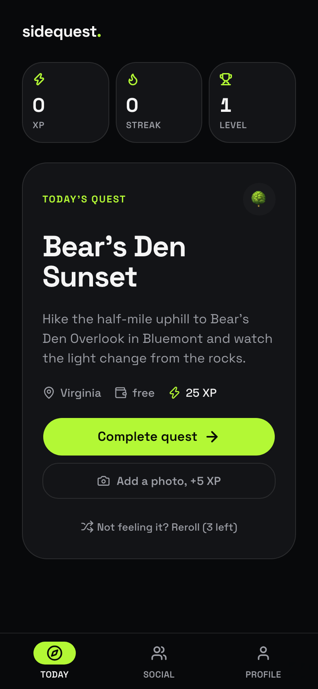
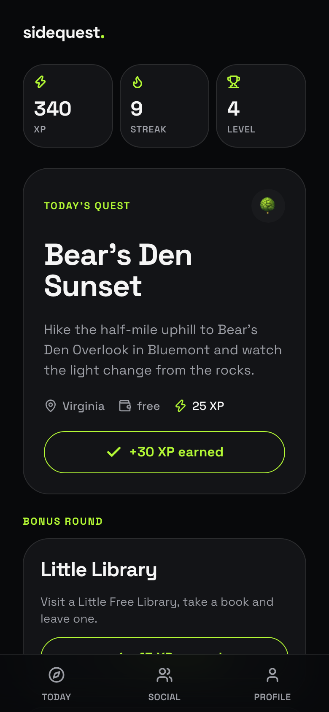
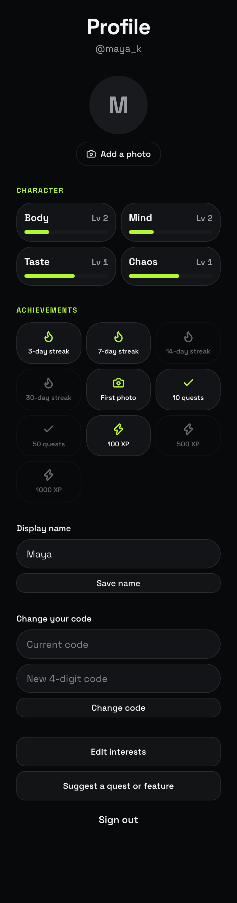
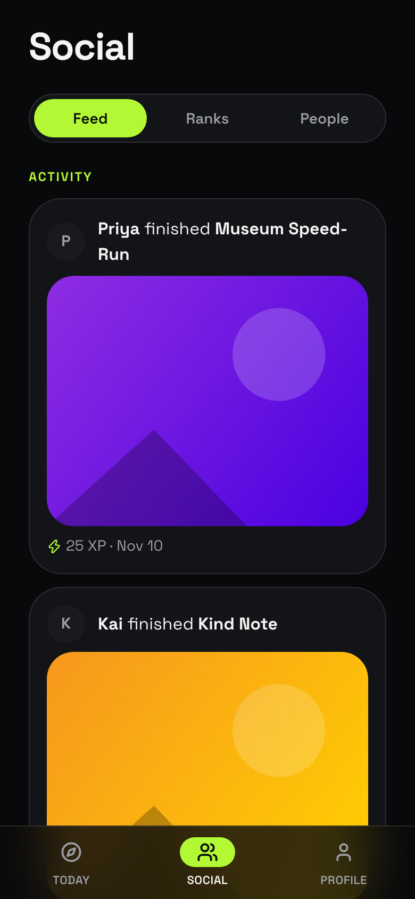
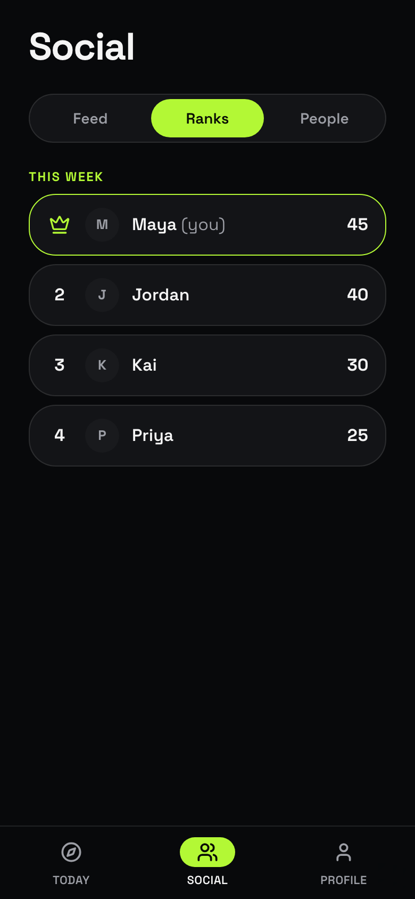
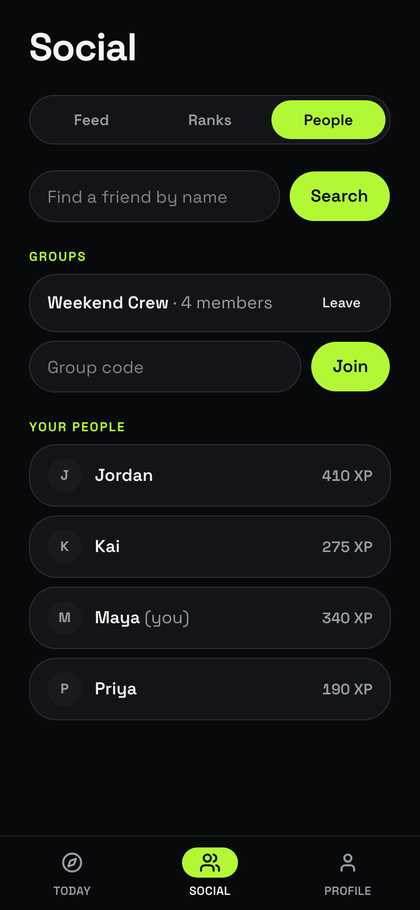

# sidequest.

A small adventure, every day. SideQuest hands you one random real-world quest in the DC / Maryland / Virginia area, like a canal stroll, a hidden-gem hike or a Little Free Library swap. You earn XP, build a streak and compete with friends.

**Live:** https://sidequestdmv.vercel.app

<p>
  
  
  
</p>
<p>
  
  
  
</p>

_Screenshots use demo accounts._

## Features

- **Daily quest:** one random quest from a hand-picked DMV pool, leaning toward your interests and learning from what you finish and skip.
- **Rerolls and bonus rounds:** skip a quest you're not feeling, or take up to two extra quick quests after you finish.
- **XP, levels and streaks:** earn XP per quest, plus a bonus for photo proof. Streaks bank extra rerolls.
- **Character and achievements:** four stats (Body, Mind, Taste, Chaos) level up from the quests you finish, and milestone cards unlock along the way.
- **Social:** a friends feed with photos, a weekly leaderboard, and groups you join with a code, so everyone in a group sees each other without friend requests.
- **Suggestions:** anyone can suggest a quest or a feature. The creator approves quests before they join the pool for everyone.
- **Simple sign-in:** a name and a 4-digit code, with no email.

## Stack

Next.js (App Router, TypeScript), Tailwind CSS and shadcn/ui, Motion, Supabase (Postgres, Auth, Storage, row-level security on every table), Vercel, pnpm, Biome.

## Run it locally

```bash
pnpm install
pnpm dev
```

Create `.env.local` with your Supabase project's public values first:

```bash
NEXT_PUBLIC_SUPABASE_URL=...
NEXT_PUBLIC_SUPABASE_PUBLISHABLE_KEY=...
```

The schema lives in `supabase/migrations/`. Apply it to your own Supabase project with `supabase db push --linked`.

| Command | What it does |
| --- | --- |
| `pnpm dev` | Dev server on http://localhost:3000 |
| `pnpm build` | Production build |
| `pnpm typecheck` / `pnpm lint` | Type check and lint |
| `pnpm test:e2e` | Browser tests (needs the dev server running and a logged-in Supabase CLI) |
